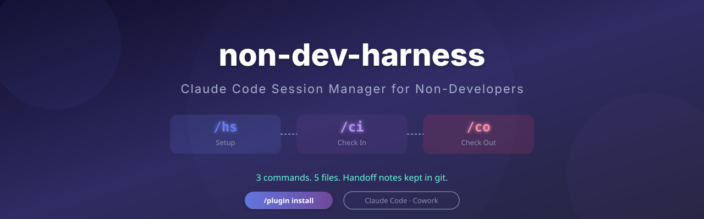
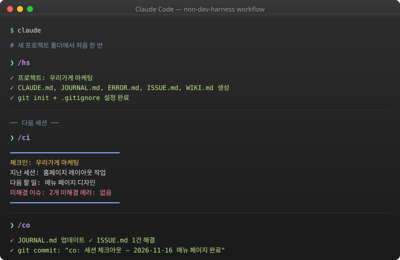
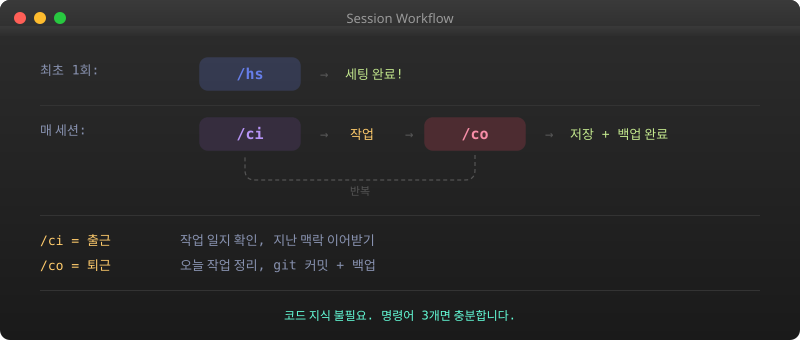
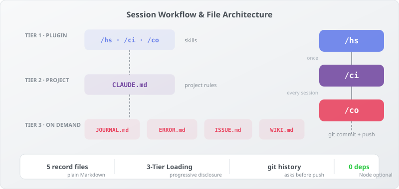

<p align="center">
  
</p>

<p align="center">
  <a href="https://github.com/calmtiger86/non-dev-harness/blob/main/LICENSE"></a>
  
  
  
</p>

<p align="center">
  <b>A Claude Code work-journal plugin for non-developers</b><br>
  <sub>Three commands to pick up where you left off, record what you did, and keep it in git. No coding needed.</sub>
</p>

<p align="center">
  <a href="./README.md">한국어</a> · 
  <b>English</b>
</p>

<p align="center">
  <a href="#-installation">Install</a> · 
  <a href="#-usage">Usage</a> · 
  <a href="#-record-files">Record files</a> · 
  <a href="#-using-it-in-cowork">Cowork</a> · 
  <a href="#-safety">Safety</a> · 
  <a href="#-updating-and-removing">Update &amp; remove</a> · 
  <a href="#-moving-from-v1">Moving from v1</a>
</p>

> The skill instructions and record file templates are written in Korean. This page is an English guide to the same plugin.

---

## Why?

Claude Code can already reopen old conversations. `claude --continue` and `/resume` bring back a previous session, and `/recap` gives you a short summary of the conversation so far.

On a project that runs for days or weeks, reopening a conversation is often not enough. You still have to dig through a long thread to find what you decided, why you decided it, and what you planned to do next. When an error you already fixed comes back, the fix is buried in some old conversation. And what you decided and what's left to do aren't kept anywhere as a document a person can read.

**non-dev-harness leaves a handoff note for your next session inside the project folder.** When you finish, type `/co`. It summarizes what you did, what you decided, which errors you fixed, and what's left, files each part into the right record file, and saves a work history with git (a tool that keeps a history of file changes). Next time, type `/ci` and it reads that summary and briefs you on where you left off. Because the records live in the project folder and in git, once you push them to GitHub you can read the same journal from another computer, and so can the people you work with.

---

## 📦 Installation

non-dev-harness is a Claude Code plugin (a bundle that adds features to Claude Code). You install it from the plugin marketplace `calmtiger86/non-dev-harness`. Pick the one method that matches where you use Claude.

### Inside Claude Code (v2.1.275 or later)

```
/plugin install non-dev-harness --marketplace calmtiger86/non-dev-harness
```

### From a terminal (v2.1.292 or later)

```bash
claude plugin install non-dev-harness --marketplace calmtiger86/non-dev-harness
```

### Claude desktop app

In the Code tab, click the **+** button next to the prompt box → **Plugins** → **Browse plugins**. Under **Add plugin → Add marketplace → Add from repository**, enter `calmtiger86/non-dev-harness`, sync, then install non-dev-harness. (Menu names were checked in the Korean UI in November 2026; the English labels may differ slightly.)

### Cowork · claude.ai

Under **Customize > Plugins > Add plugin > Add marketplace > Add from repository**, enter `calmtiger86/non-dev-harness`, sync, then click **Add** on non-dev-harness in the list. (Tested in the Korean UI in November 2026; the English labels may differ slightly.)

> If the commands don't show up after installing, type `/reload-plugins` in the running session or restart Claude Code.

**Command names.** After installing you get three commands: `/hs`, `/ci`, and `/co`. If another plugin already has a command with the same name, type the full name with the plugin prefix, such as `/non-dev-harness:ci`.

**Node.js is optional.** Node.js (a program that runs JavaScript) is used only for a one-line notice at session start and for the v1 cleanup tool. If Node.js is installed, you'll see the notice below when you start Claude Code in a harness project. If it isn't, that notice is quietly skipped. `/hs`, `/ci`, and `/co` all work without Node.js. This was confirmed on macOS. On Windows without Git Bash, the command runs in PowerShell; it is written so that PowerShell can parse it too and no error line appears, but whether the notice shows up on real Windows has not been tested yet (the three commands work either way).

```
SessionStart:startup says: non-dev-harness: 지난 작업을 이어받으려면 /ci, 마칠 때는 /co 를 입력하세요.
```

(The notice says: "To pick up your last session type /ci, and type /co when you're done.")

---

## 🚀 Usage

<p align="center">
  
</p>

### `/hs` — **H**arness **S**etup (once)

Run it once in a new project folder.

```
> /hs
```

- Asks a few questions one at a time: project name, what it does, who it's for, which tools you use, and your preferred language. It suggests answers guessed from clues like the folder name, so usually you just confirm.
- Shows you the files it will create and the actions it will take, and creates the 5 record files only after you confirm.
- Asks whether to turn on the work history (git), and creates a `.gitignore` (a list of files git should ignore) so secret files don't get recorded.
- If the new folder sits inside a larger git repository, it asks you to choose: start this folder as its own separate history, include it in the parent repository, or stop. If you pick a separate history, it asks separately whether to add this folder to the parent repository's `.gitignore` so the parent stops tracking it.
- If this folder is the top of its git repository, the GitHub CLI (`gh`) is installed, you're logged in, and no remote repository is connected yet, asks whether to back up to a private GitHub repository. It first checks whether a repository with the same name already exists.
- If the folder already has a `CLAUDE.md`, it leaves the existing text alone and appends the harness section at the end. If the folder already has the harness, it only edits the project info or creates missing files.

### `/ci` — **C**heck **I**n

The first thing you type when you start working.

```
> /ci
```

- Shows the last session's summary, your next to-dos, and recent decisions.
- Tells you how many issues and errors are still open. If 3 or more errors of the same type pile up, it warns that you may need a different approach.
- Also shows the WIKI.md table of contents, changes you haven't saved yet, and your latest history entries.
- At the end of the briefing it asks in plain text, "What should we do next?" Answer with a number or in your own words: continue working, start something new, or wrap up the last session first (/co). It doesn't start working until you answer.
- Even in a project without the harness, it briefs you from the README, existing docs, and git history.

### `/co` — **C**heck **O**ut

Type it when you're done.

```
> /co
```

- Shows which record file each of this session's decisions, errors, issues, and lessons will go into, and saves them after you confirm. It writes only what actually came up in the conversation and doesn't make up reasons or alternatives that weren't discussed.
- Unfinished to-dos are carried over to the next list or moved to ISSUE.md. If one should be dropped, it asks first.
- Shows the list of files going into git, and after you confirm, checks them for secret files and large files, then commits (records the current state as one save point).
- If a remote repository such as GitHub is connected, it asks whether to upload there too. Even when no files changed, it asks to upload if there are commits that haven't been pushed yet.
- The final summary shows, one line per file, what it actually wrote. If something needs fixing, just say so and it edits the record files and commits again.

### When confirmation prompts appear

In Claude Code's default permission mode (the mode that asks before acting), a confirmation prompt appears when a file is created or edited, and when a command changes something or sends it out, such as starting git or pushing to GitHub. Read-only checks, and the commands that record into git on this computer (staging, committing, unstaging, and setting this folder's user name and email), are pre-approved by `/hs` and `/co`, so they go through without a prompt. Setting up a new folder with `/hs` and git turned on shows about 7 prompts: 1 to start git and 1 for each of the 6 files it creates (the 5 record files and `.gitignore`). The prompt for creating a file shows that file's contents.

- If what the prompt shows matches what the preview told you, choose to allow it.
- If a command looks unfamiliar and you're unsure, you can deny it. The harness then stops and explains what it couldn't do.
- `/ci` only reads, and no prompts appeared in our test. `/co` shows a prompt each time it edits a record file, and when it pushes to GitHub.

---

## 📁 Record Files

`/hs` creates these 5 files in your project folder. They're all plain Markdown (.md) text files, so you can open, read, and edit them yourself.

| File | Think of it as | What it holds |
|------|---------------|-------------|
| **CLAUDE.md** | Bulletin board | Project info and rules. Claude Code reads it automatically every session |
| **JOURNAL.md** | Work journal | Last session summary, next to-dos, decision log, session log |
| **ERROR.md** | Fix log | What broke, what you tried, and how you fixed it |
| **ISSUE.md** | To-do list | Open issues and bugs, with 3 priority levels (🔴🟡🟢) |
| **WIKI.md** | Knowledge base | Lasting knowledge from the project, with a table of contents and topic sections |

When a file goes over its set size (5 session log entries, 10 open errors, 15 open issues), `/co` asks whether to move some entries into WIKI.md.

**JOURNAL.md is not Claude Code's auto memory.** Claude Code keeps its own notes called auto memory, and those stay on your computer only. JOURNAL.md is a human-readable work journal inside the project folder, so git shares it with your other computers and the people you work with. In a harness project, if you say "remember this," Claude checks with you whether it belongs in JOURNAL.md (decisions), WIKI.md (knowledge), or CLAUDE.md (rules) before writing it down.

---

## 🔄 Workflow

<p align="center">
  
</p>

Set up once with `/hs`. After that, start each working session with `/ci` and end it with `/co`.

<details>
<summary><b>Architecture diagram</b></summary>

<p align="center">
  
</p>

</details>

---

## 💻 Using It in Cowork

You can use the same three commands in Cowork. The differences below come from tests in Cowork on a Mac on November 16–17, 2026 (the test that installed the plugin and ran `/ci` and `/co` was on the 17th).

- **CLAUDE.md is not loaded automatically.** Cowork doesn't put the connected folder's CLAUDE.md into the conversation, so `/ci` reads it directly. In Cowork, type `/ci` first when you start working.
- **Commands run in a virtual machine.** Cowork runs commands in a Linux virtual machine inside your Mac. It has git and Node.js but not the GitHub CLI (`gh`), so `/hs` skips the GitHub connection step in Cowork.
- **The plugin's check scripts live somewhere other than your project folder.** Plugin files are in a cloud workspace while your project folder is in the virtual machine, so the scripts can't run as-is. From 2.0.3, when `/ci`, `/co`, or `/hs` can't find a script, they copy it into a fresh temporary folder on the project side (outside your project folder) for each run, and run it in one command chained to a check that it is byte-for-byte identical to the hash list shipped with the plugin (`SHA256SUMS`). If it isn't identical, it doesn't run. If that can't be confirmed, `/co` and `/hs` stop without committing.
- **Uploading to GitHub (push) doesn't work.** In our test, Cowork's shell had no GitHub login, so the push failed with `could not read Username for 'https://github.com'`. Your record files and commits stay in the folder; to back them up to GitHub, run `/co` in Claude Code on your own computer.
- **The first commit asks for your name and email.** This is the author info stored in the git history, and it's set for this project only.
- **An "allow file deletion" prompt may appear.** When committing, git wants to remove a temporary lock file it created inside the `.git` folder. It is not deleting your work files. If you decline, only the commit is skipped and your record files stay as they are.

---

## 🔒 Safety

**What `/hs` protects**

- It stops instead of setting up in broad folders: your home folder, the Desktop, Documents, or Downloads folder itself, the OneDrive folder itself, the top folder of a drive, or `~/.claude`. Personal files could end up in the records there. Instead, it asks you to create a new project folder and run it again inside.
- It never recreates or overwrites a record file that already exists.
- It writes nothing until it has shown you a preview and you've confirmed. That includes starting git, `.gitignore`, and the record files.
- It runs the same secret check as `/co` before its first commit, because files already in the folder may be recorded for the first time.
- It creates GitHub repositories as private only. A public repository is created only if you ask for one.

**What `/co` protects**

- It shows you the list of files going into git first and asks for confirmation.
- Before committing, it checks three things: secret file names (`.env`, `*.pem`, `id_rsa`, and so on), secret contents such as API keys or private keys inside files, and files larger than 50MB.
- One script (`commit-checked.sh`) does both the check and the commit. It commits only staging that passed the check, accepts no other git options, and refuses a commit message containing a `Claude-Session:` line. So even though the commit goes through without a prompt, the check can't be skipped.
- If anything is flagged, it undoes only the staging (the list of files queued for the commit) and stops. Your files stay where they are.
- For each flagged file it explains why, and asks separately whether to add it to `.gitignore` and leave it out of this save, record it anyway because it isn't a secret, or record nothing this time. "Record it anyway" applies only to that run.
- It never force-pushes (uploads by overwriting the history on GitHub). If an upload is rejected, it explains the situation and stops.
- It edits only the relevant section of each record file and never rewrites a whole file.

---

## 🔧 Updating and Removing

### Updating

- Type `/plugin` and turn on auto-update for this marketplace in the Marketplaces tab to receive new versions automatically.
- To update manually, run this in a terminal:

```bash
claude plugin update non-dev-harness@non-dev-harness
```

- In a session that's already running, type `/reload-plugins` to start using the new version.

### Removing

```bash
claude plugin uninstall non-dev-harness@non-dev-harness
```

> The record files in your project folders (CLAUDE.md, JOURNAL.md, and so on) are not deleted.

---

## 🚚 Moving from v1

If you used the older version (v1), move over in this order.

1. Install v2 using the steps under [Installation](#-installation).
2. When you start Claude Code, a notice says files from the old (v1) install are still there.
3. In that session, tell Claude **"non-dev-harness v1 정리해줘"** ("clean up non-dev-harness v1"). The cleanup tool first shows what it will remove and what it will leave alone, and after you confirm, it backs everything up to the `backups` folder in your config folder (usually `~/.claude`) and cleans up.
4. Restart Claude Code. That way `/ci` points to the new plugin's command instead of the old one.

**Converting a v1 project's record files.** In a project created with v1, the start notice and `/ci` tell you the record files are in the old format. Run `/hs` in that project folder to convert them to v2.

- MEMORY.md is renamed to JOURNAL.md.
- CLAUDE.md only gets the sections that are new in v2 (how to handle record files, principles), and you're asked whether to remove an outdated rules section that only v1 had.
- If `.gitignore` has lines that v1 added (`*.key`, `.env*`), you're asked separately whether to change them.
- Apart from the journal's title line, none of your existing records are changed, and every change is previewed and confirmed first.
- Until you convert, `/ci` and `/co` keep reading and writing MEMORY.md as before.

---

## 📐 Design

Built on patterns from 8 open-source projects:

<details>
<summary><b>See sources</b></summary>

| Project | What we took |
|--------|-----------------|
| [RTK](https://github.com/rtk-ai/rtk) | Summary extraction, hard caps, progressive filtering |
| [revfactory/harness](https://github.com/revfactory/harness) | 7-phase workflow, context pre-check, change history |
| [Karpathy CLAUDE.md](https://gist.github.com/karpathy/442a6bf555914893e9891c11519de94f) | Wiki structure, surface/minimal/surgical/verify principles |
| [addyosmani/agent-skills](https://github.com/addyosmani/agent-skills) | 6-part SKILL.md layout, interview pattern |
| [anthropics/claude-md-management](https://github.com/anthropics/claude-plugins-official) | CLAUDE.md quality criteria, include/exclude rules |
| [VoltAgent context-manager](https://github.com/VoltAgent/awesome-claude-code-subagents) | Data lifecycle |
| [VoltAgent error-coordinator](https://github.com/VoltAgent/awesome-claude-code-subagents) | Error tagging, circuit breaker, learning loop |
| [multica-ai/karpathy-skills](https://github.com/multica-ai/andrej-karpathy-skills) | 4 principles (surface assumptions, minimal code, surgical edit, verifiable goals) |

</details>

---

## 🤝 Contributing

Bug reports and suggestions are welcome, especially from non-developers.

**Running the checks.** After making changes, run these from the repository folder:

```bash
node hooks/session-start.test.mjs
node scripts/remove-v1.test.mjs
bash skills/co/scripts/check-staged.test.sh
bash skills/co/scripts/commit-checked.test.sh
bash skills/ci/scripts/status.test.sh
claude plugin validate --strict .
```

**If you changed a script,** update the hash list in the same folder too (`cd skills/co/scripts && shasum -a 256 check-staged.sh commit-checked.sh > SHA256SUMS`, and in `skills/ci/scripts`, `shasum -a 256 status.sh > SHA256SUMS`). In Cowork the skills use this list to confirm a copied script matches the original, so a stale list makes `/co` in Cowork stop without committing. The checks above verify that the list matches the scripts.

**To ship a change,** bump `version` to the same new number everywhere it appears in `.claude-plugin/plugin.json` and `.claude-plugin/marketplace.json`. If the number stays the same, users who update are told they're already on the latest version and don't get the change. After bumping it, `claude plugin tag` checks that the two files agree and creates a git tag (a label marking a release) named `non-dev-harness--v<version>`.

---

<p align="center">
  <sub>Made with Claude Code · MIT License</sub><br>
  <a href="https://github.com/calmtiger86/non-dev-harness">
    
  </a>
</p>
