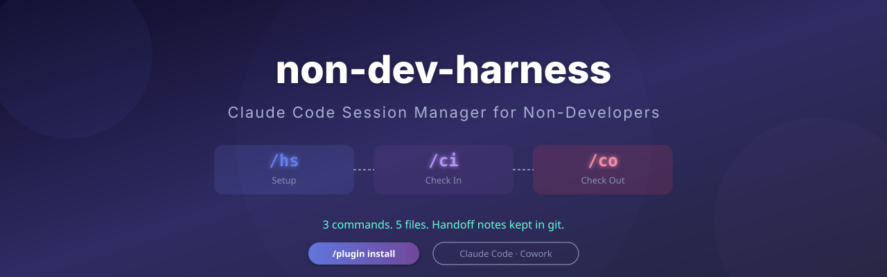
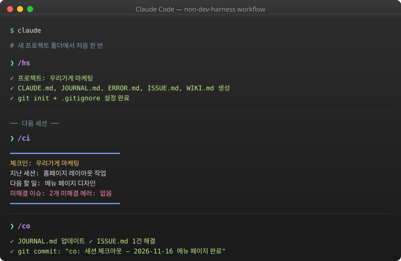
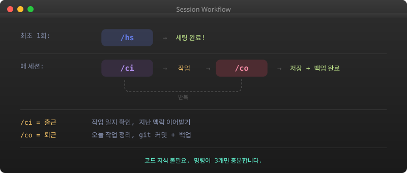
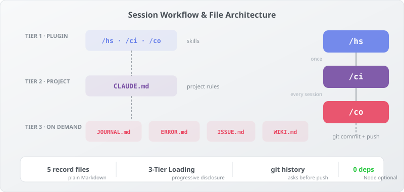

<p align="center">
  
</p>

<p align="center">
  <a href="https://github.com/calmtiger86/non-dev-harness/blob/main/LICENSE"></a>
  
  
  
</p>

<p align="center">
  <b>비개발자를 위한 Claude Code 작업 기록 플러그인</b><br>
  <sub>명령어 3개로 지난 작업을 이어받고, 오늘 한 일을 기록해 git에 남깁니다. 코딩을 몰라도 됩니다.</sub>
</p>

<p align="center">
  <b>한국어</b> · 
  <a href="./README.en.md">English</a>
</p>

<p align="center">
  <a href="#-설치">설치</a> · 
  <a href="#-사용법">사용법</a> · 
  <a href="#-기록-파일">기록 파일</a> · 
  <a href="#-cowork에서-쓸-때">Cowork</a> · 
  <a href="#-안전-장치">안전 장치</a> · 
  <a href="#-업데이트와-제거">업데이트와 제거</a> · 
  <a href="#-v1에서-옮기기">v1에서 옮기기</a>
</p>

---

## 왜 필요한가요?

Claude Code에도 지난 대화를 다시 여는 기능이 있습니다. `claude --continue`나 `/resume`으로 예전 세션을 이어 갈 수 있고, `/recap`으로 지금까지의 대화를 짧게 요약받을 수도 있습니다.

그런데 며칠, 몇 주에 걸친 프로젝트에서는 대화를 다시 여는 것만으로는 부족할 때가 많습니다. 긴 대화 속에서 "무엇을 정했고, 왜 그렇게 정했고, 다음에 무엇을 하기로 했는지"를 다시 찾아야 합니다. 지난번에 해결한 에러가 또 나와도 그 방법이 어느 대화에 있었는지 찾기 어렵습니다. 정한 것과 남은 일이 사람이 읽을 수 있는 문서로 따로 정리되어 남지도 않습니다.

**non-dev-harness는 다음 세션을 위한 인수인계 메모를 프로젝트 폴더에 남겨 줍니다.** 작업을 마칠 때 `/co`를 입력하면 오늘 한 일, 정한 것, 해결한 에러, 남은 일을 요약해 기록 파일에 나눠 적고, git(파일이 바뀐 이력을 저장하는 도구)으로 작업 기록을 남깁니다. 다음에 `/ci`를 입력하면 그 요약을 읽고 어디까지 했는지 브리핑해 줍니다. 기록이 프로젝트 폴더와 git에 있으므로, GitHub에 올려 두면 다른 컴퓨터에서도, 함께 일하는 사람도 같은 일지를 읽을 수 있습니다.

---

## 📦 설치

non-dev-harness는 Claude Code 플러그인(기능을 덧붙이는 확장 묶음)입니다. 플러그인을 내려받는 목록인 마켓플레이스 `calmtiger86/non-dev-harness`에서 설치합니다. 쓰는 곳에 맞는 방법 하나만 고르세요.

### Claude Code 안에서 (v2.1.275 이상)

```
/plugin install non-dev-harness --marketplace calmtiger86/non-dev-harness
```

### 터미널에서 (v2.1.292 이상)

```bash
claude plugin install non-dev-harness --marketplace calmtiger86/non-dev-harness
```

### Claude 데스크톱 앱

프롬프트 입력창 옆의 **+** 버튼을 누르고, **Add plugins**에서 마켓 `calmtiger86/non-dev-harness`를 추가한 뒤 non-dev-harness를 설치합니다.

### Cowork · claude.ai

**Customize > Plugins > Add marketplace**에 `calmtiger86/non-dev-harness`를 넣어 마켓을 추가한 뒤 non-dev-harness를 설치합니다.

> 설치한 뒤 명령이 보이지 않으면, 실행 중인 세션에서 `/reload-plugins`를 입력하거나 Claude Code를 다시 시작하세요.

**명령 이름.** 설치하면 `/hs`, `/ci`, `/co` 세 명령을 쓸 수 있습니다. 다른 플러그인에 같은 이름의 명령이 있으면 `/non-dev-harness:ci`처럼 플러그인 이름을 앞에 붙인 정식 이름으로 입력하세요.

**Node.js는 없어도 됩니다.** Node.js(자바스크립트 실행 프로그램)는 세션을 시작할 때 띄우는 안내 한 줄과 v1 정리 도구에만 쓰입니다. Node.js가 있으면 하네스 프로젝트에서 Claude Code를 시작할 때 아래 안내가 보이고, 없으면 이 안내만 조용히 건너뜁니다. `/hs`, `/ci`, `/co`는 Node.js 없이 모두 동작합니다. 이 동작은 macOS에서 확인했고, Git Bash가 없는 Windows에서는 아직 확인하지 못했습니다.

```
SessionStart:startup says: non-dev-harness: 지난 작업을 이어받으려면 /ci, 마칠 때는 /co 를 입력하세요.
```

---

## 🚀 사용법

<p align="center">
  
</p>

### `/hs` — **H**arness **S**etup (처음 한 번)

새 프로젝트 폴더에서 처음 한 번 실행합니다.

```
❯ /hs
```

- 프로젝트 이름, 하는 일, 대상, 쓰는 도구, 선호 언어를 하나씩 묻습니다. 폴더 이름 같은 단서로 짐작한 답을 먼저 보여 주므로 대개 확인만 하면 됩니다.
- 만들 파일과 실행할 일을 미리 보여 주고, 확인을 받은 뒤에만 기록 파일 5개를 만듭니다.
- 작업 기록(git)을 켤지 묻고, 비밀 파일이 올라가지 않도록 `.gitignore`(git이 무시할 파일 목록)를 만듭니다.
- GitHub CLI(`gh`)가 설치되어 있고 로그인되어 있으면, GitHub 비공개 저장소에 백업할지 묻습니다.
- 이미 `CLAUDE.md`가 있는 폴더라면 기존 내용은 그대로 두고 하네스 안내만 끝에 덧붙입니다. 하네스가 이미 있는 폴더라면 프로젝트 정보만 고치거나 빠진 파일만 만듭니다.

### `/ci` — **C**heck **I**n (출근)

작업을 시작할 때 가장 먼저 입력합니다.

```
❯ /ci
```

- 지난 세션 요약, 다음 할 일, 최근에 정한 것을 보여 줍니다.
- 아직 풀지 못한 이슈와 에러가 몇 개인지 알려 줍니다. 같은 종류의 에러가 3건 이상 쌓이면 다른 방법이 필요할 수 있다고 경고합니다.
- WIKI.md 목차, 아직 저장하지 않은 변경, 최근 작업 기록도 함께 보여 줍니다.
- 그다음 이어서 작업할지, 새로 시작할지, 지난 작업을 먼저 정리할지 고르게 하고, 스스로 작업을 시작하지는 않습니다.
- 하네스가 없는 프로젝트에서도 README, 기존 문서, git 기록을 읽고 브리핑합니다.

### `/co` — **C**heck **O**ut (퇴근)

작업을 마칠 때 입력합니다.

```
❯ /co
```

- 이번 세션의 결정, 에러, 이슈, 배운 점을 어느 기록 파일에 적을지 미리 보여 주고, 확인을 받은 뒤 저장합니다.
- 끝내지 못한 "다음 할 일"은 다음 목록에 이어 적거나 ISSUE.md로 옮깁니다. 지워야 할 때는 먼저 묻습니다.
- git에 올라갈 파일 목록을 보여 주고 확인을 받은 뒤, 비밀 파일과 큰 파일을 검사하고 커밋(지금 상태를 저장 시점 하나로 기록하는 일)합니다.
- GitHub 같은 원격 저장소가 연결되어 있으면 그곳에도 올릴지 묻습니다.

---

## 📁 기록 파일

`/hs`는 프로젝트 폴더에 아래 5개 파일을 만듭니다. 모두 마크다운(.md) 글 파일이라 직접 열어 읽고 고칠 수 있습니다.

| 파일 | 비유 | 역할 |
|------|------|------|
| **CLAUDE.md** | 사무실 게시판 | 프로젝트 정보와 규칙. Claude Code가 세션마다 자동으로 읽습니다 |
| **JOURNAL.md** | 업무 일지 | 마지막 세션 요약, 다음 할 일, 의사결정 이력, 세션 로그 |
| **ERROR.md** | 문제 해결 노트 | 에러가 났을 때 무엇을 시도했고 어떻게 고쳤는지 |
| **ISSUE.md** | 할 일 목록 | 아직 끝나지 않은 이슈와 버그. 우선순위 3단계(🔴🟡🟢) |
| **WIKI.md** | 백과사전 | 프로젝트에서 배운, 오래 두고 쓸 지식. 목차와 주제별 섹션 |

기록이 정해 둔 개수(세션 로그 5개, 미해결 에러 10개, 미해결 이슈 15개)를 넘으면, `/co`가 기록 일부를 WIKI.md로 옮길지 묻습니다.

**JOURNAL.md는 Claude Code의 자동 기억과 다릅니다.** Claude Code는 auto memory(자동 기억)라는 메모를 스스로 남기는데, 이 메모는 내 컴퓨터에만 있습니다. JOURNAL.md는 프로젝트 폴더 안에 있는, 사람이 읽는 작업 일지라서 git으로 다른 컴퓨터나 함께 일하는 사람과 공유됩니다. 하네스 프로젝트에서 "이거 기억해 줘"라고 하면, Claude는 내용에 따라 JOURNAL.md(결정), WIKI.md(지식), CLAUDE.md(규칙) 가운데 어디에 적을지 확인한 뒤 적습니다.

---

## 🔄 워크플로우

<p align="center">
  
</p>

처음 한 번 `/hs`로 세팅하고, 그 뒤로는 작업할 때마다 `/ci`로 시작해 `/co`로 마칩니다.

<details>
<summary><b>구조 그림</b></summary>

<p align="center">
  
</p>

</details>

---

## 💻 Cowork에서 쓸 때

Cowork에서도 같은 세 명령을 쓸 수 있습니다. 아래 차이 가운데 GitHub push 항목은 공식 문서를 근거로 하고, 나머지는 2026년 11월 16일에 맥에서 시험해 확인했습니다.

- **CLAUDE.md를 자동으로 읽지 않습니다.** Cowork는 연결한 폴더의 CLAUDE.md를 대화에 자동으로 싣지 않으므로 `/ci`가 직접 읽습니다. Cowork에서는 작업을 시작할 때 `/ci`를 먼저 입력하세요.
- **명령은 가상 컴퓨터에서 실행됩니다.** Cowork의 명령은 맥 안에서 돌아가는 Linux 가상 머신에서 실행됩니다. 여기에는 git과 Node.js가 있고 GitHub CLI(`gh`)는 없습니다. 그래서 `/hs`는 Cowork에서 GitHub 연결 단계를 건너뜁니다.
- **GitHub에 올리는 일(push)은 막혀 있을 수 있습니다.** 공식 문서에 따르면 Cowork는 기본 설정에서 GitHub로 올리는 것을 막습니다. 이 항목은 직접 올려 보며 확인하지는 않았습니다. 막히더라도 기록 파일과 커밋은 폴더에 그대로 남으니, GitHub 백업은 내 컴퓨터의 터미널이나 Claude Code에서 `/co`를 하면 됩니다.
- **첫 커밋 때 이름과 이메일을 묻습니다.** git 기록에 남길 작성자 정보이며, 이 프로젝트에만 설정합니다.
- **"파일 삭제 허용" 창이 뜰 수 있습니다.** 커밋할 때 git이 `.git` 폴더 안에 잠깐 만든 잠금 파일을 지우려는 것이고, 작업 파일을 지우는 것이 아닙니다. 허용하지 않으면 커밋만 건너뛰고 기록 파일은 그대로 남습니다.

---

## 🔒 안전 장치

**`/hs`가 지키는 것**

- 홈 폴더, 바탕화면·문서·다운로드 폴더 자체, 드라이브 맨 위 폴더, `~/.claude` 같은 넓은 폴더에서는 세팅하지 않고 멈춥니다. 개인 파일까지 기록될 수 있기 때문입니다. 대신 프로젝트용 새 폴더를 만들어 그 안에서 다시 실행하라고 안내합니다.
- 이미 있는 기록 파일은 어떤 경우에도 다시 만들거나 덮어쓰지 않습니다.
- 미리보기를 보여 주고 확인을 받기 전에는 아무것도 쓰지 않습니다. git 시작, `.gitignore`, 기록 파일이 모두 여기에 들어갑니다.
- GitHub 저장소는 비공개로만 만듭니다. 공개 저장소는 사용자가 따로 요청할 때만 만듭니다.

**`/co`가 지키는 것**

- git에 올라갈 파일 목록을 먼저 보여 주고 확인을 받습니다.
- 커밋하기 전에 세 가지를 검사합니다. 비밀 파일 이름(`.env`, `*.pem`, `id_rsa` 등), 파일 안에 든 API 키나 개인 키 같은 비밀 내용, 50MB가 넘는 파일입니다.
- 하나라도 걸리면 커밋할 목록에 올려 둔 것(스테이징)만 되돌리고 멈춥니다. 파일은 그대로 남습니다. 어떤 파일이 왜 걸렸는지 설명하고 `.gitignore`에 넣는 방법을 안내합니다.
- 강제 push(GitHub에 있는 기록을 덮어쓰며 올리기)는 하지 않습니다. 올리기가 거절되면 상황을 설명하고 멈춥니다.
- 기록 파일은 해당 섹션만 고치고, 파일 전체를 새로 쓰지 않습니다.

---

## 🔧 업데이트와 제거

### 업데이트

- `/plugin`을 입력하고 Marketplaces 탭에서 이 마켓의 자동 업데이트를 켜 두면 새 버전을 자동으로 받습니다.
- 직접 받으려면 터미널에서 아래 명령을 실행합니다.

```bash
claude plugin update non-dev-harness@non-dev-harness
```

- 이미 실행 중인 세션에서는 `/reload-plugins`를 입력해야 새 버전이 적용됩니다.

### 제거

```bash
claude plugin uninstall non-dev-harness@non-dev-harness
```

> 프로젝트 폴더의 기록 파일(CLAUDE.md, JOURNAL.md 등)은 지워지지 않고 그대로 남습니다.

---

## 🚚 v1에서 옮기기

예전 방식(v1)으로 설치해 쓰던 분은 아래 순서로 옮기면 됩니다.

1. 위의 [설치](#-설치) 방법으로 v2를 설치합니다.
2. Claude Code를 시작하면 "예전 방식(v1)으로 설치된 파일이 남아 있습니다"라는 안내가 뜹니다.
3. 그 세션에서 Claude에게 **"non-dev-harness v1 정리해줘"** 라고 말합니다. 정리 도구가 지울 것과 건드리지 않을 것을 미리 보여 주고, 확인을 받은 뒤 설정 폴더(보통 `~/.claude`)의 `backups` 폴더에 백업하고 정리합니다.
4. Claude Code를 다시 시작합니다. 그래야 `/ci`가 옛 명령이 아니라 새 플러그인의 명령을 가리킵니다.

**v1 프로젝트의 기록 파일 바꾸기.** v1으로 만든 프로젝트에서는 시작 안내와 `/ci`가 기록 파일이 옛 형식이라고 알려 줍니다. 그 프로젝트 폴더에서 `/hs`를 실행하면 v2 형식으로 바꿉니다.

- MEMORY.md의 이름을 JOURNAL.md로 바꿉니다.
- CLAUDE.md에는 v2에서 새로 생긴 섹션(기록 파일 다루는 법, 원칙)만 덧붙이고, v1에만 있던 낡은 규칙 섹션은 지울지 묻습니다.
- 쌓인 기록 내용은 한 줄도 바꾸지 않으며, 모든 변경을 미리 보여 주고 확인을 받은 뒤에 합니다.
- 바꾸기 전이라도 `/ci`와 `/co`는 MEMORY.md를 그대로 읽고 씁니다.

---

## 📐 설계 원칙

8개 오픈소스를 분석해서 좋은 패턴만 골랐습니다.

<details>
<summary><b>참고한 프로젝트 보기</b></summary>

| 프로젝트 | 가져온 패턴 |
|------|------------|
| [RTK](https://github.com/rtk-ai/rtk) | 요약 추출, 개수 제한, 단계적 필터링 |
| [revfactory/harness](https://github.com/revfactory/harness) | 7단계 워크플로우, 컨텍스트 사전 점검, 변경 이력 |
| [Karpathy CLAUDE.md](https://gist.github.com/karpathy/442a6bf555914893e9891c11519de94f) | Wiki 구조, 가정표면화/최소구현/부분수정/검증 4원칙 |
| [addyosmani/agent-skills](https://github.com/addyosmani/agent-skills) | 6파트 SKILL.md 구조, 인터뷰 패턴 |
| [anthropics/claude-md-management](https://github.com/anthropics/claude-plugins-official) | CLAUDE.md 품질 기준, 포함/제외 규칙 |
| [VoltAgent context-manager](https://github.com/VoltAgent/awesome-claude-code-subagents) | 데이터 생명주기 |
| [VoltAgent error-coordinator](https://github.com/VoltAgent/awesome-claude-code-subagents) | 에러 분류 태그, 반복 차단기, 학습 루프 |
| [multica-ai/karpathy-skills](https://github.com/multica-ai/andrej-karpathy-skills) | 4원칙 (가정 표면화, 최소 구현, 부분 수정, 검증 목표) |

</details>

---

## 🤝 기여

버그 신고나 개선 제안은 언제든 환영합니다. 비개발자분들의 피드백을 특히 기다립니다.

**고친 내용을 배포하려면** `.claude-plugin/plugin.json`과 `.claude-plugin/marketplace.json`에 있는 `version`을 모두 같은 새 번호로 올려야 합니다. 번호가 그대로면 사용자가 업데이트해도 "이미 최신"이라고 나오고 새 내용을 받지 못합니다. 번호를 올린 뒤 `claude plugin tag`를 실행하면 두 파일의 번호가 맞는지 확인하고 `non-dev-harness--v<버전>` 형식의 git 태그(배포 시점에 붙이는 이름표)를 만듭니다.

---

<p align="center">
  <sub>Made with Claude Code · MIT License</sub><br>
  <a href="https://github.com/calmtiger86/non-dev-harness">
    
  </a>
</p>
